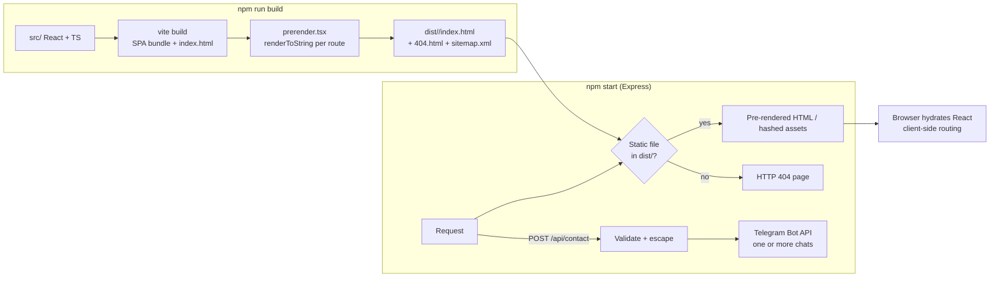

# ADVANCED AUDIT — Corporate Website

**Fast, SEO-first corporate website for an audit and financial consulting firm in Tashkent: a React 19 SPA that is pre-rendered to static HTML for every route, served by a small Express server that also forwards contact-form leads to Telegram.**


Live site: [advanced-audit.uz](https://advanced-audit.uz)

---

## Overview

An audit company needs a site that looks premium, loads fast on mobile, ranks in Google for local queries like *“аудит Ташкент”*, and turns visitors into calls or requests.

A plain single-page app is invisible to search engines without JavaScript and serves the same HTML for every URL. This project keeps the developer experience of a React SPA but, at build time, **pre-renders every route** (home page + 7 service landing pages + 404) into its own `index.html` with its own title, description, canonical URL and structured data, regenerates `sitemap.xml`, and lets the Express server return a real HTTP 404 for unknown paths.

## Features

- **Pre-rendering / SSG:** `prerender.tsx` renders each route with `react-dom/server` + `StaticRouter`, injects per-page `<title>`, meta description, canonical and Open Graph / Twitter tags, writes `dist/<route>/index.html`, and rebuilds `sitemap.xml`.
- **Service landing pages** generated from one data file (`src/content/pages.ts`): mandatory audit, tax audit, initiative audit, IFRS transformation, accounting services, tax consulting, plus a local “audit in Tashkent” page — each with breadcrumbs, cross-links and `FAQPage` JSON-LD.
- **Structured data:** `Organization`/business JSON-LD in `index.html`, FAQ markup on service pages, Google Search Console verification.
- **Bilingual UI** (Russian / Uzbek) via a typed `LanguageContext`, and a **light/dark theme** via `ThemeContext`.
- **Home page sections:** hero with background video, about, manifesto, services, process, industries, clients with animated counters and a full client list modal, team cards with detail modal, final call-to-action and contact section.
- **Lead form → Telegram:** `POST /api/contact` escapes user input for Telegram HTML and broadcasts the request to one or several chat IDs (`Promise.allSettled`, so one blocked recipient does not lose the lead).
- **Performance:** gzip/brotli via `compression`, immutable 1-year caching for hashed assets, `must-revalidate` for HTML, client-only lazy background videos that respect `prefers-reduced-motion`, CSS-only decorative background (no WebGL), hydration of the pre-rendered markup instead of a full re-render.
- **Polish:** scroll-progress bar, custom cursor, reveal-on-scroll animations (IntersectionObserver), Framer Motion modals, per-page meta updates on client-side navigation (`usePageMeta`).

## How it works



## Tech stack

| Layer | Technology |
|---|---|
| UI | React 19, TypeScript, Tailwind CSS 4, Framer Motion / Motion, lucide-react, react-countup |
| Routing | React Router 7 (`BrowserRouter` in the browser, `StaticRouter` during pre-render) |
| Build | Vite 6, `@vitejs/plugin-react`, `tsx` for the Node scripts |
| Server | Express 4, `compression`, `dotenv`; Vite middleware in development |
| Integrations | Telegram Bot API |
| Deployment | Any Node host behind a reverse proxy (e.g. Nginx + PM2) |

## Project structure

```
advanced-audit-website/
├── src/
│   ├── App.tsx                 # routes: home, service pages, 404
│   ├── main.tsx                # client entry (hydration)
│   ├── LanguageContext.tsx     # RU/UZ dictionary + provider
│   ├── ThemeContext.tsx        # light/dark theme
│   ├── content/                # service landing pages data (pages.ts) + types
│   ├── pages/                  # HomePage, NotFoundPage
│   ├── components/             # Navbar, Hero, Services, Clients, Team, Contact, Footer, ServicePage ...
│   │   └── ui/                 # Section, Logo, BackgroundVideo, Cursor, ScrollProgress
│   ├── hooks/                  # usePageMeta, useReveal, useScrollProgress, ...
│   └── index.css               # Tailwind + design tokens
├── public/                     # logo, favicon, og-image, robots.txt, videos, team photo placeholder
├── index.html                  # HTML template with SEO meta and JSON-LD
├── prerender.tsx               # static pre-render of all routes + sitemap
├── server.ts                   # Express: static hosting, real 404, /api/contact -> Telegram
├── vite.config.ts
├── SEO-DEPLOY.md               # deploy & SEO notes (Russian)
├── start-site.cmd / start.ps1  # Windows helpers: npm install + npm run dev
├── package.json / package-lock.json
└── .env.example
```

## Setup

**Requirements:** Node.js 20+ and npm.

```bash
git clone https://github.com/Umar37-max/advanced-audit-website.git
cd advanced-audit-website
npm install
cp .env.example .env        # fill in the Telegram values
npm run dev                 # http://localhost:3000 (Express + Vite middleware)
```

### Environment variables

| Variable | Where | Description |
|---|---|---|
| `PORT` | server | HTTP port (default `3000`) |
| `NODE_ENV` | server | `production` serves `dist/`, anything else runs Vite in middleware mode |
| `TELEGRAM_BOT_TOKEN` | server | Bot token used by `/api/contact` |
| `TELEGRAM_CHAT_ID` | server | One chat ID or several, comma-separated |
| `SITE_URL` | build | Domain used for canonical URLs and the sitemap (default `https://advanced-audit.uz`) |
| `DISABLE_HMR` | dev | `true` disables Vite HMR |

## Usage

```bash
npm run dev       # development server with HMR
npm run build     # vite build + prerender (always use this, not plain `vite build`)
npm start         # production server (set NODE_ENV=production)
npm run lint      # type-check with tsc
```

Production example:

```bash
npm ci && npm run build
NODE_ENV=production PORT=3000 npm start
```

Put the app behind a reverse proxy with HTTPS. Content of the service pages lives in `src/content/pages.ts`; UI strings live in `src/LanguageContext.tsx`.

## Security & privacy note

- Secrets (`TELEGRAM_BOT_TOKEN`, `TELEGRAM_CHAT_ID`) are read only on the server from environment variables; `.env` is git-ignored and nothing secret is injected into the client bundle.
- User input from the contact form is HTML-escaped before it is sent to Telegram.
- **No personal data is included:** team member names, bios and photos were replaced with neutral placeholders (`Сотрудник N` / `Xodim N`, `public/team/placeholder.svg`); deployment archives, build output and local tool configs are excluded.
- Phone numbers, e-mail and client company names shown in the UI are the firm's public business information from the live website.

---

**Русский:** Корпоративный сайт аудиторской компании на React 19 + Vite с пререндерингом каждой страницы для SEO, двумя языками (RU/UZ), тёмной темой и отправкой заявок в Telegram через Express-сервер. Секреты хранятся только в переменных окружения.
